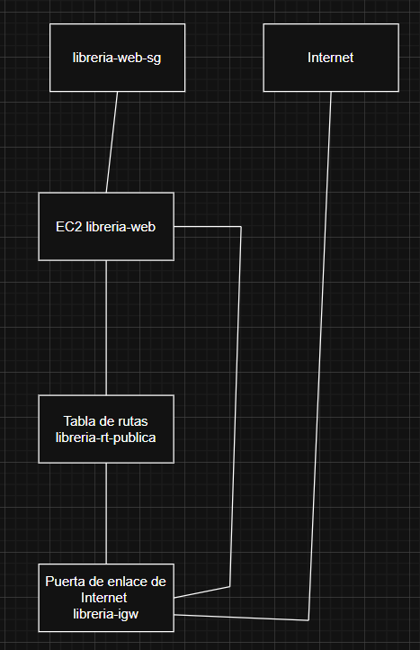
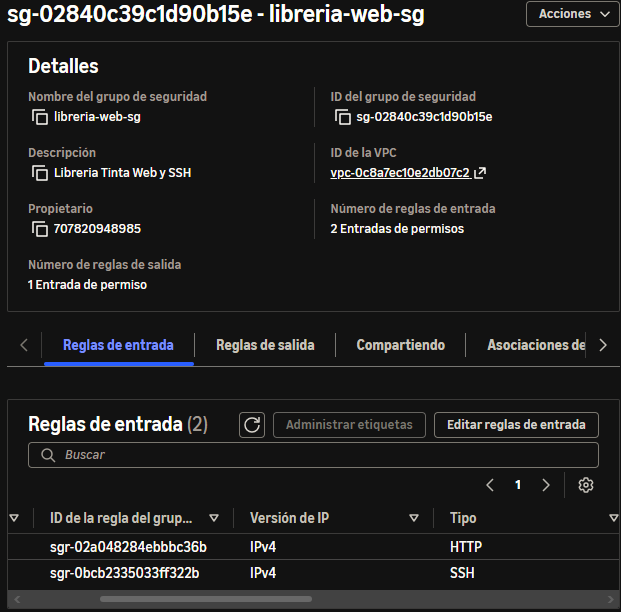

# Librería Tinta en AWS

Despliegue de dos versiones de una web estática con Nginx en AWS Academy Learner Lab, en Norte de Virginia (`us-east-1`).

## Arquitectura



## Red (B1)

La VPC `libreria-vpc` usa el bloque `10.0.0.0/16`. La subred `libreria-publica` usa `10.0.1.0/24` en `us-east-1a`. La subred es pública porque su tabla de rutas, `libreria-rt-publica`, envía el tráfico con destino `0.0.0.0/0` a la puerta de enlace `libreria-igw`. La asignación automática de IPv4 pública está habilitada.

| Recurso | Captura |
| --- | --- |
| VPC | [Detalles](img/01-vpc.png) |
| Subred | [Detalles](img/02-subred.png) y [asignación de IPv4](img/03-subred-ip-publica.png) |
| Internet Gateway | [Asociación con la VPC](img/04-igw.png) |
| Tabla de rutas | [Rutas](img/05-rutas.png) |

## Grupo de seguridad (B2)

`libreria-web-sg` permite HTTP en TCP 80 desde cualquier IPv4. SSH en TCP 22 se limita a la IP pública de mi conexión mediante una regla `/32`, para restringir el acceso de administración.



## Servidor web y acceso SSH (B3)

`libreria-web` es una instancia EC2 `t3.micro` con Amazon Linux 2023 y el par de claves `vockey`. Los datos de usuario de [user-data1.sh](scripts/user-data1.sh) instalan Nginx, publican la primera versión y arrancan el servicio.

- [Detalles de EC2](img/08a-detalles-instancia.png) y [captura adicional](img/08b-detalles-instancia.png).
- [Etiquetas](img/09-etiquetas.png).
- [Versión 1 en el navegador](img/10-web-v1.png).
- [Prueba de acceso SSH](img/11-ssh.png).

## DNS privado ponderado (nivel medio)

La segunda EC2 publica la [versión 2](img/13-web-v2.png) con [user-data2.sh](scripts/user-data2.sh). La [zona privada libreria.lab](img/14-zona-alojada.png) está asociada a la VPC. Los dos [registros A ponderados](img/15-registros-dns.png) responden al nombre `web.libreria.lab`.

| Registro | IPv4 privada | Peso |
| --- | --- | ---: |
| `version-1` | `10.0.1.240` | 80 |
| `version-2` | `10.0.1.59` | 20 |

La [prueba desde EC2 por SSH](img/16-prueba-dns-ssh.png) muestra ambas versiones al consultar el mismo nombre con `dig` y `curl`. Se dejó un TTL de 10 segundos para repetir la consulta con una pausa de 11 segundos.

## Presupuesto (B4 y nivel medio)

Las capturas de la calculadora muestran [7,60 USD/mes](img/12-presupuesto.png) y [3,80 USD/mes](img/17-presupuesto-medio.png). Esta última solo muestra Amazon EC2. Queda confirmar qué incluye cada estimación y añadir los enlaces compartidos. La estimación del nivel medio debe incluir dos EC2 encendidas 24/7, sus discos, sus IPv4 públicas y la zona privada de Route 53. Para reducir el coste de cómputo durante las pruebas se pueden detener las instancias cuando no se estén usando.

## Despliegue con AWS CLI (nivel avanzado)

[desplegar.sh](scripts/desplegar.sh) reutiliza la red de B1, prepara el grupo `libreria-web-cli-sg` y despliega una instancia `libreria-web-cli` con el HTML de la versión 1. En una segunda ejecución busca y reutiliza la instancia existente.

En CloudShell, coloca `desplegar.sh` y `user-data1.sh` en la misma carpeta, revisa los IDs de VPC y subred y configura `MI_IP` con la IPv4 pública de tu conexión seguida de `/32`. Ejecuta:

```bash
bash -n desplegar.sh && bash desplegar.sh
```

La [captura de CloudShell](img/20a-consola-cloudshell.png) muestra el mismo ID en ambas ejecuciones. La [captura del navegador](img/20b-segunda-ejecucion.png) muestra la web que abrió la URL devuelta. Queda documentar el coste de la instancia de prueba y su limpieza después de grabar.

## Vídeo de demostración

Pendiente de añadir el enlace.

## Uso de IA

Utilicé ChatGPT para consultar cómo comprobar el acceso SSH, montar el DNS ponderado y completar la plantilla de Bash. Dos consultas que me sirvieron fueron «Quiero saber qué IP tengo que poner en el comando SSH» y «¿Cuál es el contenido del script del nivel avanzado?».

En la primera revisión del DNS, ChatGPT propuso comprobar primero que la versión 2 respondía por su IP privada y revisar el TTL. Al contrastarlo con la captura de Route 53 se vio además que ambos registros apuntaban a IP públicas. Corregí los valores para usar las IPv4 privadas y repetí las consultas desde EC2 hasta ver las dos versiones.
